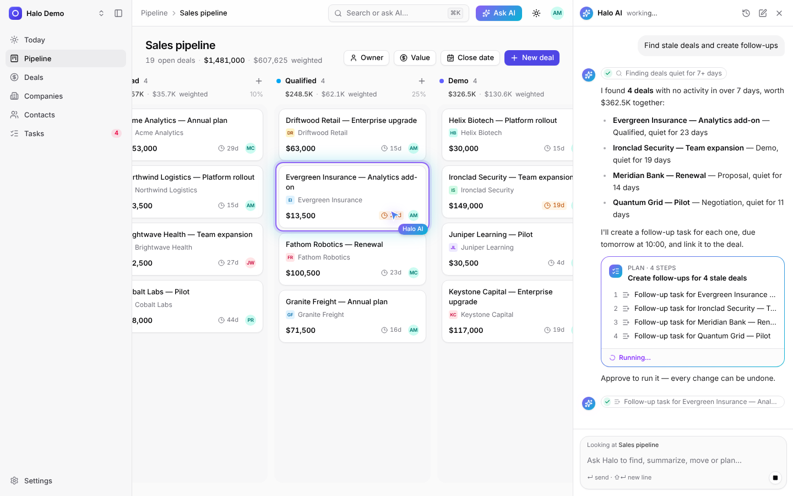
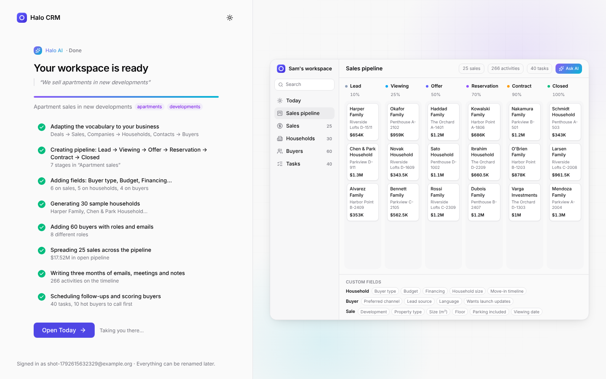
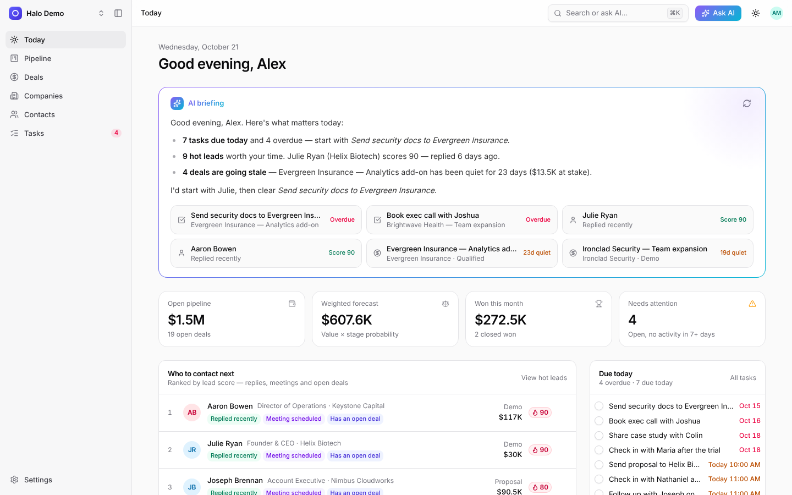
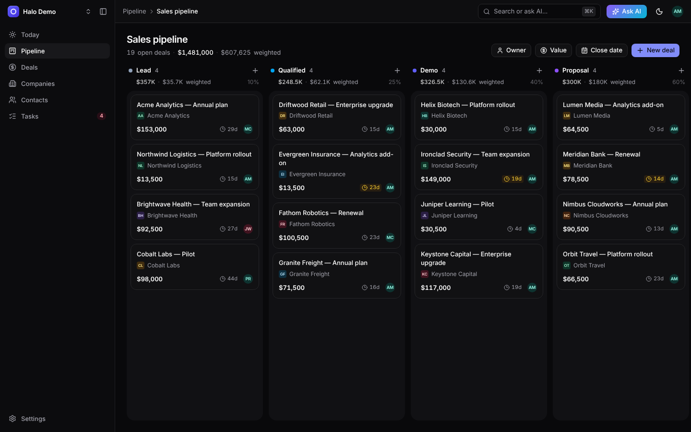
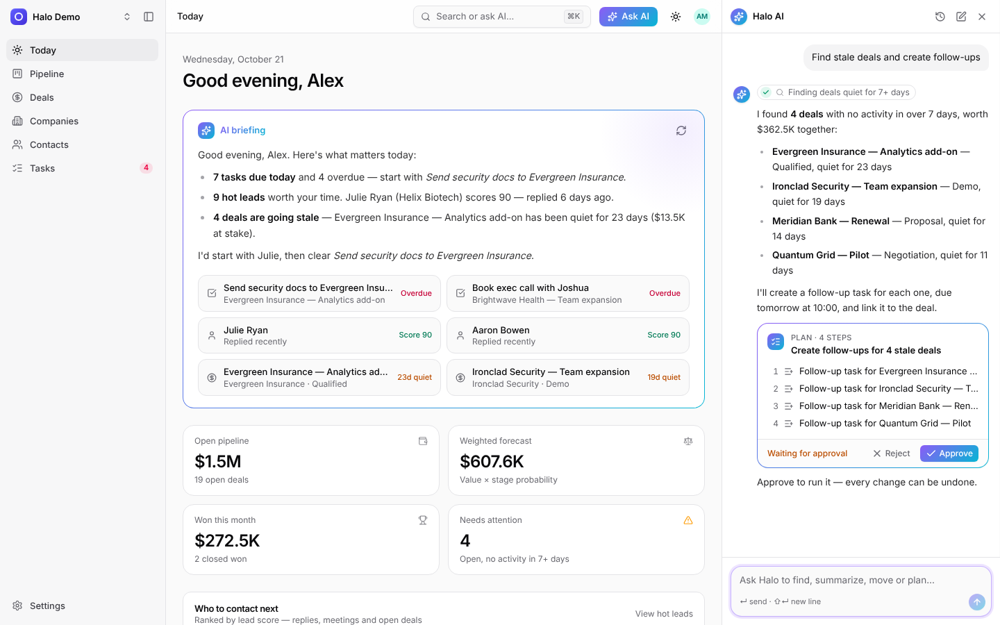
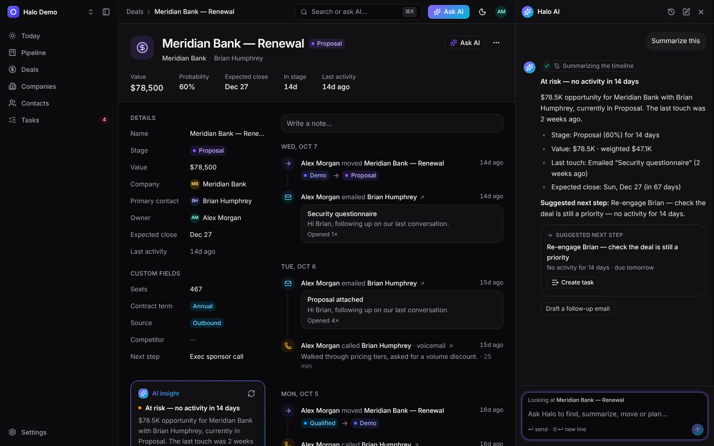
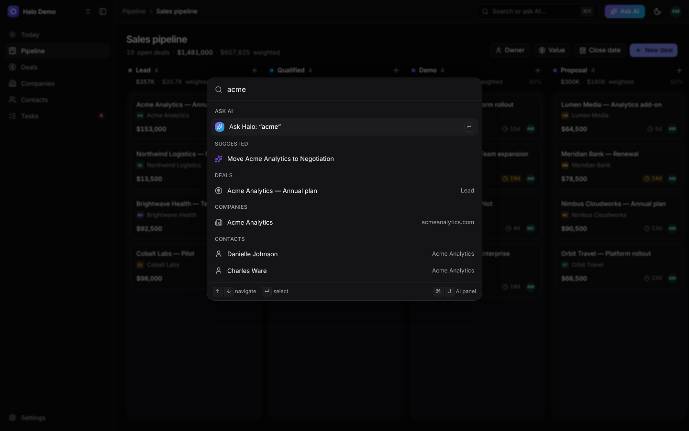
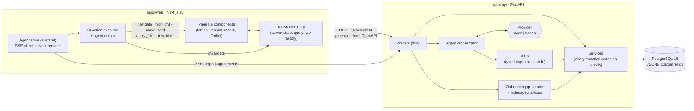
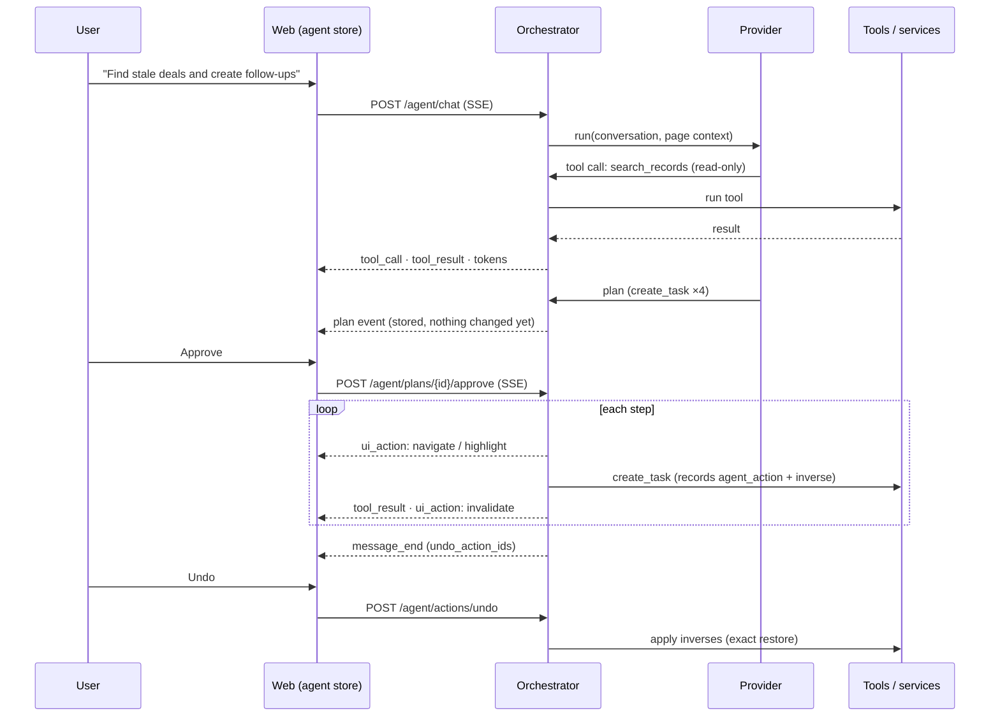

# Halo CRM

**An AI-native B2B CRM where the agent works alongside you, inside the interface.** It plans,
asks for confirmation, then visibly acts: it navigates, highlights records, slides kanban cards
and creates tasks. Every action can be undone.



- **Set up in one sentence.** Describe your business ("We sell apartments in new developments")
  and the workspace assembles on screen: pipeline stages, custom fields, vocabulary
  (Deals → *Sales*, Companies → *Households*) and realistic sample data.
- **An agent you can watch.** Read-only answers stream in immediately. Anything that changes data
  becomes a *plan* you approve first. Then a cursor moves through the app doing the work, and
  one click undoes it exactly.
- **A real CRM underneath.** Companies, contacts, deals, tasks, notes and an activity timeline,
  with custom fields on every object, a drag-and-drop pipeline, explainable lead scores and a
  Today page that tells you who to call next.
- **Runs without an API key.** The default agent provider is a deterministic mock that queries
  real data through the same tools a real model would use. Set `LLM_PROVIDER=openai` to use any
  OpenAI-compatible model instead.

---

## Quickstart

Requirements: **Python 3.12** with [uv](https://docs.astral.sh/uv/), **Node 22** with pnpm, and
**Docker** (for Postgres 16).

```bash
make setup   # install api + web dependencies, create .env files
make up      # start Postgres 16 in Docker
make seed    # apply migrations and load the demo workspace (idempotent)
make dev     # api on http://localhost:8000, web on http://localhost:3000
```

Open <http://localhost:3000> and either **sign up** (to see onboarding) or sign in with the demo
account **`demo@halo.dev` / `demo1234`**.

> Already running Postgres 16? Skip `make up` and point `DATABASE_URL` in `.env` at it.
> Tests use a second database (`TEST_DATABASE_URL`, default `halo_test`), which
> `docker compose` creates for you.

---

## Demo script

The whole flow takes about five minutes. Each step uses only the UI.

| # | Do this | Watch for |
|---|---|---|
| 1 | **Sign up**, then type *"We sell industrial equipment to factories"* (or click a chip) → **Build my workspace** | Steps check off on the left. On the right, a live miniature of the app relabels its sidebar (*Opportunities, Customers*), drops in kanban columns one by one and fills them with sample deals and fields. Then it lands on Today. |
| 2 | **Today** | The AI briefing streams in. *Who to contact next* ranks people by score, with reason chips (*Replied recently*, *Meeting scheduled*…). |
| 3 | `⌘K` → *"Find stale deals and create follow-ups"* → **Approve** | A plan card lists one task per stale deal. After approval the agent cursor highlights each deal on the pipeline, the tasks appear, and **Undo** removes them all again. |
| 4 | Ask *"Move Acme to Negotiation"* → **Approve** | The agent resolves "Acme" to the *Acme Analytics — Annual plan* deal, and the card slides into the Negotiation column. **Undo** slides it back. |
| 5 | Open a contact → **Draft email** in the AI insight → **Save as note** | An email card with a draft based on the real timeline; saving adds it to the timeline. |
| 6 | Ask *"How's the pipeline this month?"* | A short narrative and a chart card, built from live pipeline numbers. |
| 7 | **Settings → Fields → Add field** | The new column appears in the table straight away, with no code change. |

Keyboard: `⌘K` search/ask, `⌘J` AI panel, `C` create, `G` then `P`/`D`/`O`/`C`/`K`/`T` to
navigate, `?` for all shortcuts.

---

## Screens

| | |
|---|---|
|  |  |
| **Onboarding:** one sentence → a workspace with matching stages, fields, vocabulary and data | **Today:** streamed briefing, ranked contact queue, due tasks, pipeline health |
|  |  |
| **Pipeline:** drag and drop, totals and weighted value per stage, stale indicators | **Plans:** every change is proposed first, then approved |
|  |  |
| **Records:** fields, timeline, related records and an AI insight with a suggested next step | **⌘K:** search records, jump anywhere, or ask the agent |

More screenshots per phase live in [`docs/screens/`](docs/screens).

---

## Architecture



### How an agent turn works



### Design choices that matter

- **A typed event protocol.** Every SSE payload is a Pydantic model (`app/agent/events.py`),
  exported through OpenAPI. The web types are generated from it, so the backend and frontend
  can't drift apart.
- **Plans are data.** A plan stores tool calls plus the UI actions to show around each step. A
  generic executor runs any approved plan, whichever provider proposed it. Mutating tools called
  outside an approved plan are refused by the orchestrator.
- **Exact undo.** Tools snapshot what they change, and the activities they write are collected,
  so undo restores rows and timelines precisely. Tests check this down to `updated_at`.
- **Watchable UI actions.** Actions run one at a time, and each resolves only when its animation
  finishes. The executor reuses the same cache updates as drag and drop, so a card moved by the
  agent animates exactly like one moved by hand.
- **One source of truth for fields.** System columns and custom field definitions become one
  list of field descriptors, which drives tables, detail panels, inline editors and filters.
- **Universality through data.** Industry templates define terminology, stages, fields and seed
  flavour. The UI reads the workspace's vocabulary everywhere, and the agent uses it in replies.
- **Deterministic demo.** Seed data comes from a fixed seed (per workspace for new sign-ups), so
  every reset is identical and the mock agent's replies are reproducible, while still being
  built from real queries.

More reasoning is in [`DECISIONS.md`](DECISIONS.md); what was built, phase by phase, is in
[`PROGRESS.md`](PROGRESS.md).

---

## Plugging in a real LLM

The agent talks to a **provider**: an async generator that yields text, tool calls, plans, UI
actions and cards (`app/agent/providers/base.py`). Two providers ship:

| Provider | When | What it does |
|---|---|---|
| `mock` *(default)* | Demos, tests, CI | An intent router plus scenario scripts. They call the real tools and write replies from actual data, with realistic pacing. |
| `openai` | `LLM_PROVIDER=openai` | Any OpenAI-compatible Chat Completions API (OpenAI, Azure OpenAI, vLLM, Ollama, LM Studio…) with streaming function calling. |

To use a real model, set these in `.env` and restart the API:

```bash
LLM_PROVIDER=openai
OPENAI_API_KEY=sk-...
OPENAI_BASE_URL=https://api.openai.com/v1   # or e.g. http://localhost:11434/v1 for Ollama
OPENAI_MODEL=gpt-4o-mini
```

How the safety contract holds with a real model:

- Read-only tools (`search_records`, `get_record`, `pipeline_stats`, `summarize_record`,
  `draft_email`, `navigate`) are exposed as functions the model can call directly.
- Mutating tools (`create_task`, `update_record`, `move_deal_stage`, `add_note`) are **not**
  callable directly. The model has to call `propose_plan`. Each step is validated against the
  tool's Pydantic schema and stored as a plan, and the user approves it before anything runs.
  Invalid steps go back to the model as errors.
- Approved plans run through the same executor as the mock, so cursor animations,
  `invalidate` refreshes and exact undo work the same way.

To add another backend (for example Anthropic's Messages API), implement `run()` and
`execute_plan()` from the `LLMProvider` protocol, reuse `MockProvider().execute_plan` for
approved plans, and register it in `app/agent/providers/__init__.py`.
`tests/test_openai_provider.py` shows how to test a provider against a scripted fake server.

---

## Project layout

```
apps/
  api/                      FastAPI · SQLAlchemy 2 (async) · Alembic · Pydantic v2
    app/
      models/  schemas/     ORM models, request/response models
      services/             business logic (scoping, fields, scoring, activities, …)
      routers/              thin HTTP layer (REST + SSE)
      agent/                orchestrator, tools, providers, scenarios, insights, undo
      onboarding/           industry templates + streamed workspace generator
      seed/                 deterministic workspace builder (demo + onboarding)
    tests/                  pytest (125 tests: API, isolation, agent scenarios, undo, query counts)
  web/                      Next.js 15 · Tailwind v4 · shadcn/ui · TanStack Query/Table · motion
    src/
      app/                  routes: (auth), onboarding, (app)/today|pipeline|deals|…
      components/           ui primitives, layout, records, pipeline, agent, onboarding
      hooks/  stores/  lib/ data hooks, zustand stores, agent protocol/executor, utils
    tests/e2e/              Playwright (auth, records, pipeline, settings, agent, onboarding, a11y)
docs/screens/               screenshots per phase
```

---

## Commands

| Command | What it does |
|---|---|
| `make setup` | install api (uv) and web (pnpm) dependencies, create `.env` |
| `make up` / `make down` | start / stop Postgres via docker compose |
| `make migrate` | apply Alembic migrations |
| `make seed` | migrate and load the deterministic demo workspace (idempotent) |
| `make dev` | run the API (`uvicorn --reload :8000`) and web (`next dev :3000`) together |
| `make types` | regenerate the typed web API client from the API's OpenAPI schema |
| `make lint` / `make typecheck` / `make test` | ruff + ESLint · mypy (strict on agent/services) + tsc · pytest + Vitest |
| `make check` | all of the above |
| `make e2e` | Playwright end-to-end tests, including an axe WCAG 2.1 AA audit (needs `make dev` running) |

The demo can also be reset from the app (workspace menu → *Reset demo data*) or with
`POST /api/v1/demo/reset` (disabled when `ENV=prod`).

### Quality gates

- **API:** 125 pytest tests. They cover every router's happy and error paths, workspace
  isolation, field validation, scoring, each agent scenario's event sequence and database
  effects, exact undo, onboarding (*"We sell apartments in new developments"* → a real-estate
  workspace), the OpenAI-compatible provider, and SQL query counts (no N+1, 500-row lists in
  ~50 ms).
- **Web:** Vitest for the SSE parser, event reducers, optimistic board moves and formatting.
  Playwright end-to-end flows for auth, records, pipeline, settings, the agent (plan → approve
  → undo, card moves), onboarding, shortcuts, and axe accessibility checks.
